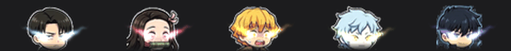

# anime-taskbar

Animated chibi anime heads that live on the Windows 11 taskbar, between the Widgets (weather) button and Start.
Their eyes burn with each character's own color, and they **get tired as your PC works harder**. Nothing to
install for the overlay itself: it runs on the PowerShell and .NET that ship with Windows.



| Mood | When | What they do |
|---|---|---|
| 😌 Calm | CPU < 40% and RAM < 70% | gentle breathing, steady eye fire with long flame trails |
| 😅 Busy | CPU 40–75% or RAM 70–88% | faster bobbing and swaying, sweat drop, hotter fire, slight blush |
| 🥵 Exhausted | CPU ≥ 75% or RAM ≥ 88% | heads slump and droop, panting, sweat, steam puffs, red cheeks, eye fire sputtering out |

Characters: Levi (icy silver), Nezuko (pink), Zenitsu (gold), Mitsuki (snake green), Sung Jin-Woo (shadow violet).

## Run it

```powershell
powershell -NoProfile -ExecutionPolicy Bypass -STA -File .\TaskbarGif.ps1
```

- Hover the tray icon to see live CPU / RAM and the current mood; right-click it → **Exit** to stop, or
  **Restart Explorer (re-dock)** if the heads are missing (see Limitations).
- Preview a mood without loading your PC: add `-Mood calm`, `-Mood busy` or `-Mood exhausted`.
- Start automatically at sign-in: `.\Install-Autostart.ps1` (undo with `.\Install-Autostart.ps1 -Uninstall`).
  It launches through `conhost --headless`, so no console window flashes.

The overlay docks inside the taskbar, so it stays visible while Start or Search is open. It is click-through (the
taskbar under it keeps working), follows the Start button as apps are pinned or opened, re-docks by itself when
Explorer restarts, hides while a fullscreen game, video or presentation is running, and only one copy runs at a time.

## Customize

Rebuilding the sprites needs Python 3.10+ with `pip install -r requirements.txt`.

- **Moods** (droop angle, sweat drops, steam, fire strength…): edit `MOODS` at the top of `make_moods.py`.
- **Characters / colors**: edit `characters/characters.json`. Each entry points at an image and gives
  - `cell`: a box holding the whole character on a dark, plain background (sticker-style art with a light outline cuts out best),
  - `box`: the head crop, `eyes`: the two pupil centers, `glow`: the eye-fire color as `[r, g, b]`.

  All coordinates are pixels in the source image.
- **Load thresholds**: `CPU_BUSY`, `CPU_EXHAUSTED`, `RAM_BUSY`, `RAM_EXHAUSTED` in `TaskbarGif.ps1`.

Then rebuild and restart the overlay:

```powershell
python make_moods.py characters\characters.json heads
```

## How it works

- `make_from_images.py` cuts each character off its background (flood fill from the cell edges, keeping only the
  connected character so loose sweat drops and labels drop out) and crops the head.
- `make_moods.py` poses the heads (bob, tilt, slump), paints sweat and blush, adds additive light for eye fire and
  steam, and writes one looping sprite sheet per mood (`heads_<mood>.png`) plus `heads.json`. Every mood loops back
  to its starting pose, so the player swaps moods at frame 0 without a jump.
- `TaskbarGif.ps1` compiles a small C# overlay at startup: a click-through layered child window inside
  `Shell_TrayWnd`, drawn with `UpdateLayeredWindow` (true per-pixel alpha, so glows blend with the taskbar) and
  positioned by UI Automation between `WidgetsButton` and `StartButton` (falling back to the task-icon strip when
  UI Automation can't see them). CPU comes from the `% Processor Utility` counter (what Task Manager shows),
  smoothed; RAM from `GlobalMemoryStatusEx`. A new mood must hold for ~3 s before the heads follow it.
- Why a child window: the first time Start or Search opens, Windows moves the taskbar into a higher window band
  for good, above every ordinary always-on-top window. A window docked inside the taskbar moves with it.

## Limitations

- Windows 11 only, primary monitor only, tuned for a 48 px taskbar at 100% display scaling.
- Needs the Widgets button to be visible, since the overlay sits between it and Start.
- The overlay can only dock before Start or Search has been opened since Explorer last started; after that the
  taskbar refuses new child windows. Autostart at sign-in docks in time. If you launch it later, the tray tooltip
  says it can't dock; use **Restart Explorer (re-dock)** from the tray menu (it closes File Explorer windows).

## Credits

The character artwork (`characters/chibi_sheet.png`) is AI-generated fan art. Levi Ackerman, Nezuko Kamado,
Zenitsu Agatsuma, Mitsuki and Sung Jin-Woo belong to their respective creators and publishers; this is a
non-commercial fan project, not affiliated with or endorsed by them.
